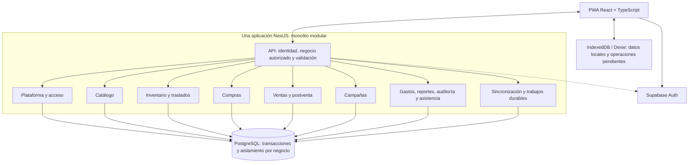

# VEXOR: propuesta de monolito modular

Fecha: 20 de octubre de 2026.

La arquitectura **monolítica** fue confirmada por el usuario. La organización modular y las prácticas descritas aquí son una **propuesta técnica para revisión**. El stack base ya acordado se conserva. Este documento acompaña al [modelo inicial de datos](MODELO_DATOS_INICIAL.md); no constituye una implementación ni una garantía de capacidad.

## 1. Organización propuesta

Una aplicación backend NestJS, organizada por capacidades del negocio, y una base PostgreSQL compartida. Cada módulo concentra sus reglas y ofrece operaciones explícitas a los demás. La PWA es el cliente del monolito; Supabase Auth es el servicio de identidad ya elegido.

Las flechas a PostgreSQL indican persistencia; no conceden acceso libre a las tablas de otros módulos. El código se comunica mediante servicios internos, sin llamadas HTTP entre módulos. Las consultas de reportes pueden combinar datos con permisos y contratos de lectura definidos.

NestJS encapsula proveedores dentro de módulos y permite exportar interfaces de uso; esa capacidad respalda esta organización. [Documentación de módulos](https://docs.nestjs.com/modules).

## 2. Responsabilidades y dependencias

| Módulo | Responsabilidad y límite |
| --- | --- |
| Plataforma | Negocios, planes, suscripciones y habilitación del servicio. Administrar VEXOR no concede automáticamente acceso a datos comerciales. |
| Acceso | Identidad, pertenencia, roles, permisos individuales y alcance por local. Comprueba vigencia y revocación de concesiones al autorizar cada operación. |
| Catálogo | Productos, variantes, presentaciones, códigos y precios. No modifica cantidades. |
| Inventario | Conteos, saldos, movimientos y disponibilidad. Es el único módulo que aplica cambios de existencias. |
| Traslados | Orquesta salida y recepción mediante inventario. El tránsito se conserva hasta su recepción o resolución. |
| Compras | Documento de compra y recepción física. Registrar una compra no implica que toda la mercadería llegó. |
| Ventas | Carritos, venta, descuento y cobros. Coordina con inventario la confirmación atómica. |
| Postventa | Cambios, devoluciones y correcciones autorizadas. Coordina dinero y mercadería según la política pendiente de precisar. |
| Campañas | Jornada, total declarado, tandas y etiquetas. Separa el registro de ingresos del registro posterior de salidas. |
| Gastos | Salidas de dinero del negocio. Evita volver a contabilizar compras o reembolsos ya reconocidos por otra vía. |
| Reportes | Consultas autorizadas sobre hechos registrados. Señala información incompleta y costos pendientes. |
| Auditoría | Responsable, acción, momento y contexto de operaciones sensibles. |
| Sincronización | Recepción idempotente, cambios incrementales, confirmaciones y seguimiento de conflictos. Reutiliza las reglas de cada módulo. |
| Asistente | Orientación y propuestas revisables mediante operaciones autorizadas. No obtiene acceso SQL irrestricto ni modifica stock por su cuenta. |

Una carpeta por módulo; dentro, separar entrada HTTP, casos de uso, reglas y persistencia cuando resulte útil. Evitar un servicio universal con todas las reglas, dependencias circulares y repositorios de otros módulos importados indiscriminadamente. No introducir abstracciones sin uso concreto.

## 3. Consistencia de las operaciones

### Venta y concurrencia

Propuesta para confirmar una venta online:

1. Verificar identidad, pertenencia, permiso, local habilitado y datos recibidos.
2. Iniciar una transacción y establecer su contexto de negocio autorizado.
3. Registrar o reclamar la clave de operación para impedir ejecuciones duplicadas, incluso simultáneas.
4. Bloquear los saldos afectados en un orden estable y comprobar stock, conteo confirmado y precios/descuentos permitidos.
5. Guardar venta y sus líneas, cobros, movimiento y actualización de saldos, auditoría mínima y cambios para sincronización.
6. Confirmar todo junto. Si falla antes del commit, no queda una venta a medias. Responder con el resultado estable de la operación.

Los saldos se deben verificar dentro de la misma transacción que los modifica. Dos peticiones no pueden vender ambas la última unidad online por haber leído antes la misma cantidad. Las operaciones sobre varios productos adquieren bloqueos en el mismo orden; los errores transitorios admiten reintentos acotados de la transacción completa con la misma clave de operación. PostgreSQL documenta los [bloqueos por fila](https://www.postgresql.org/docs/current/explicit-locking.html) y las obligaciones de [aislamiento y reintento](https://www.postgresql.org/docs/current/transaction-iso.html).

Si dos celulares cobraron sin conexión, el servidor conserva ambas ventas al sincronizar y registra la diferencia. El camino de sincronización distingue ese hecho ya ocurrido de una nueva solicitud online de venta; no intenta corregirlo borrando una venta. La política de autorización y resolución de conflictos sigue pendiente.

### Límite de una transacción

Una transacción PostgreSQL puede abarcar venta e inventario porque pertenecen a la misma aplicación y base. No esperar llamadas de IA, generación de documentos o servicios externos mientras se mantienen bloqueos de stock.

Para trabajo posterior, guardar un trabajo durable en la misma transacción del hecho que lo origina; procesarlo con reintentos y consumidores idempotentes. Esto cubre la caída entre guardar la venta y comenzar la tarea. Es una aplicación del patrón [transactional outbox](https://docs.aws.amazon.com/prescriptive-guidance/latest/cloud-design-patterns/transactional-outbox.html). El trabajo puede ejecutarlo el mismo monolito; no requiere adoptar microservicios. El mecanismo físico de ejecución queda por elegir.

Los futuros pagos externos no caben dentro de la transacción local. El alcance actual solo registra cobros declarados en efectivo, Yape y Plin; no se ha aprobado una pasarela ni una validación bancaria automática.

## 4. Aislamiento y permisos

El usuario aclaró que dos trabajadores con el mismo rol pueden tener permisos distintos y que el propietario administra la expiración de permisos concedidos. La propuesta los representa con `permisos_otorgados`, sin imponer solicitudes ni aprobaciones en la aplicación. El descuento excepcional se limita a su venta y no modifica la política general. La recomendación de consumir esa excepción una sola vez sigue pendiente de aceptación.

- Compartir base y tablas, identificando el negocio en cada fila comercial, incluidas líneas, auditoría comercial y registros de sincronización.
- Validar en NestJS el usuario y su pertenencia actual. El `tenant_id` recibido es una solicitud de contexto, no una prueba de acceso.
- Operar los datos comerciales de la PWA mediante NestJS. Mantener las tablas del negocio en un esquema no expuesto por la API de datos de Supabase, o retirar los permisos de acceso directo correspondientes. La autenticación del navegador no debe permitir saltarse las reglas del monolito escribiendo saldos o pagos por otra API.
- Aplicar RLS con un rol de ejecución sin privilegio para omitirla. Separar credenciales de migración/administración de las del tráfico normal.
- Establecer el contexto del negocio dentro de la transacción, en la misma conexión, y con duración local a ella. No conservar un tenant como estado de sesión reutilizable por el pool.
- Transportar explícitamente la identidad validada al contexto de la transacción cuando las políticas la necesiten. Una conexión SQL de NestJS no recibe automáticamente la identidad de Supabase Auth del navegador.
- Repetir autorización en sincronización, trabajos diferidos, exportaciones y asistente. La caché, los archivos y los datos locales también deben estar separados por negocio.
- Comprobar el inicio, vencimiento, alcance y revocación del permiso individual al ejecutar la operación. Si se adopta uso único, consumir la concesión y confirmar la operación en la misma transacción. Cambiar fechas o retirar una concesión deja auditoría; no borra el hecho previamente autorizado.
- Definir las relaciones para que una fila de un negocio no pueda vincularse con una fila de otro. El diseño físico deberá reforzarlo con integridad referencial compatible con `tenant_id`.
- Filtrar y construir respuestas según permisos: RLS por filas no oculta por sí sola el costo dentro de una fila accesible. No enviar costos al celular de una vendedora sin permiso, ni en una descarga offline.
- Mantener los roles de administración de plataforma fuera de los roles que un propietario puede editar. Cualquier acceso de soporte a un negocio requiere una política explícita y registro; no queda autorizado por esta propuesta.

PostgreSQL advierte que superusuarios, roles con `BYPASSRLS` y normalmente el propietario de la tabla pueden omitir RLS. Los permisos SQL y las políticas se deben diseñar conjuntamente. [PostgreSQL RLS](https://www.postgresql.org/docs/current/ddl-rowsecurity.html), [Supabase RLS](https://supabase.com/docs/guides/database/postgres/row-level-security). Supabase Auth permite comprobar tokens; esa comprobación no reemplaza la autorización de negocio. [JWT en Supabase](https://supabase.com/docs/guides/auth/jwts).

## 5. Offline y sincronización

Flujo propuesto: preparar datos autorizados del local → guardar operación y efecto local de forma atómica en IndexedDB → enviar cuando haya conexión → aplicar una vez en servidor → confirmar resultado → descargar cambios autorizados.

- Cada operación tiene un identificador generado en el celular y estable entre reintentos, negocio, dispositivo, autor, versión de contrato y contenido verificable. El identificador del dispositivo no autentica al usuario.
- El servidor compara la clave y la huella del contenido: la misma clave con el mismo contenido devuelve el resultado previo; con contenido diferente produce conflicto. La reclamación de clave y el efecto comercial se confirman juntos.
- La cola de salida se persiste antes de mostrar la venta como guardada. Un timeout no demuestra que el servidor haya fallado; reintentar no debe cobrar ni descontar otra vez.
- Guardar fecha del hecho, fecha de captura y recepción del servidor. No ordenar toda la sincronización por el reloj del celular.
- Sincronizar únicamente el catálogo, precios y existencias necesarios para vender en los locales autorizados. Descargar cambios paginados, incluyendo bajas y cambios de permisos.
- El cursor de cambios necesita orden de confirmación fiable o un protocolo que gestione huecos. Un autoincremental asignado antes del commit no basta para garantizar que nunca se omita una transacción que confirmó después. Definir y probar el protocolo antes de implementar descargas incrementales.
- Preparar una descarga inicial consistente y continuar con cambios sin dejar una brecha entre ambos pasos. Si expira el historial incremental, permitir una nueva descarga sin destruir operaciones locales pendientes.
- Conservar resultados y claves de deduplicación durante un plazo mayor que el máximo de reenvío admitido; esos plazos deben definirse juntos. No purgar una clave mientras un dispositivo todavía pueda reenviar la operación.
- Diferenciar pendiente, confirmado, con diferencia y requiere revisión. Mostrar al trabajador qué quedó guardado solo en el celular.
- Ante revocación de acceso, aislar lo pendiente y solicitar una resolución autorizada. No atribuir ventas antiguas a otro usuario ni descartarlas silenciosamente. La continuidad de sesión offline y sus plazos siguen abiertos.
- Versionar tanto el contrato de sincronización como la base IndexedDB. Una actualización de la PWA no puede borrar ventas pendientes; probar interrupciones durante migraciones y actualizaciones.

El almacenamiento del navegador tiene cuotas y puede eliminarse según las condiciones del dispositivo; solicitar persistencia y vigilar espacio ayuda, pero no convierte IndexedDB en un respaldo garantizado. Diseñar una recuperación operativa y sincronización frecuente sin bloquear la venta. [Documentación de almacenamiento](https://developer.mozilla.org/en-US/docs/Web/API/Storage_API/Storage_quotas_and_eviction_criteria).

## 6. Datos y trazabilidad

- Identificadores estables compatibles con creación offline. No usar números correlativos comerciales como identidad técnica de sincronización.
- Dinero con representación decimal exacta o unidades monetarias enteras; definir redondeos y moneda. Cantidades con precisión definida por unidad. No calcular importes con coma flotante binaria sin una estrategia decimal. [Tipos numéricos de PostgreSQL](https://www.postgresql.org/docs/current/datatype-numeric.html).
- En documentos confirmados, conservar nombre, presentación, equivalencia, precio y descuento aplicados. Cambiar después el catálogo no altera la venta histórica.
- Guardar fechas técnicas con zona horaria y la jornada comercial por separado. Los reportes del negocio usan su zona horaria; las tandas capturadas después pertenecen a la jornada declarada.
- Mantener movimientos confirmados y corregir mediante contramovimientos vinculados, en lugar de reescribir el pasado. Registrar quién autorizó y por qué.
- Mantener un saldo operativo actualizado transaccionalmente con el historial. No sumar millones de movimientos para mostrar cada búsqueda de producto. Verificar periódicamente la coherencia saldo/historial.
- Una ubicación orientativa no aporta otra cantidad sumable. En modo exacto, el detalle y el total deben cuadrar. La disponibilidad vendible distingue tránsito y mercadería no apta cuando se defina su tratamiento.
- Costos desconocidos permanecen desconocidos. La estrategia de valorización y costo de venta debe decidirse antes de mostrar ganancias; la estructura inicial no elige promedio ni FIFO.
- JSON sirve para preferencias o metadatos delimitados, con validación y versión. Ventas, pagos, cantidades y relaciones principales permanecen estructurados.

## 7. Capacidad y operación

La capacidad se demuestra con carga representativa. No se puede afirmar un número de negocios o celulares con solo elegir monolito y PostgreSQL.

| Área | Recomendación inicial | Evidencia para ampliarla |
| --- | --- | --- |
| API | Peticiones acotadas, validación de tamaño, paginación y límites por usuario/negocio. Evitar trabajo pesado en el hilo que atiende peticiones. | Latencia p95/p99, errores, CPU, memoria y demora del event loop. |
| Base de datos | Pool acotado y transacciones breves. Presupuestar conexiones de todas las réplicas, trabajos y servicios de Supabase. | Espera por conexión, consultas lentas, bloqueos, CPU e I/O. |
| Consultas | Diseñar índices desde los filtros reales de negocio/local/fecha y RLS; revisar planes de ejecución. El listado concreto queda para el esquema físico. | Tiempo y filas examinadas en búsquedas, ventas, reportes y sincronización. |
| Reportes | Consultas paginadas; agregados o trabajos diferidos cuando la medición lo justifique. Separar ingresos de campaña y detalle de productos. | Tiempo de consulta e impacto en las ventas concurrentes. |
| Imágenes/archivos | Archivos fuera de filas transaccionales, con referencias y acceso por negocio. Proveedor aún por elegir. | Peso de descarga, cuota del celular y tráfico. |
| Escalado | Primero corregir consultas y dimensionar recursos. El monolito puede tener varias réplicas si no depende de memoria local para estado compartido. | Prueba de carga que muestre el cuello de botella. |
| Trabajos | Ejecución durable, reintentos limitados, exclusión entre ejecutores y recuperación de tareas abandonadas. | Antigüedad de pendientes, fallos y tiempo de procesamiento. |
| Respaldo | Respaldos verificables y ensayo de restauración. Incluir archivos además de base. Definir pérdida y tiempo de recuperación tolerables. | Restauración probada y registros de respaldo. |

Un pool reutiliza conexiones; el límite total depende también de los servicios de Supabase. Las réplicas de NestJS no multiplican por sí solas la capacidad de PostgreSQL. [Conexiones y pools](https://supabase.com/docs/guides/database/connecting-to-postgres/pooling-and-limits). NestJS documenta [límites de peticiones](https://docs.nestjs.com/security/rate-limiting) y [procesamiento mediante colas](https://docs.nestjs.com/techniques/queues); no se elige todavía Redis ni BullMQ. Los respaldos de base de Supabase no incluyen los objetos de Storage. [Respaldos](https://supabase.com/docs/guides/platform/backups).

Los planes gratuitos ya elegidos sirven para desarrollo y pruebas. El dimensionamiento y alojamiento de producción siguen abiertos. No fijar particionado, réplicas de lectura o cachés adicionales sin un problema medido.

## 8. Validación necesaria antes del uso real

Estos son escenarios de aceptación propuestos para la futura implementación; no pruebas ya ejecutadas:

1. Un trabajador del negocio A intenta consultar y modificar registros de B por API, identificador directo, sincronización, reportes y trabajos: ninguna vía permite acceso.
2. Dos vendedores online intentan vender la última unidad: solo una operación ordinaria confirma; la otra recibe el resultado de disponibilidad correspondiente.
3. Dos ventas ya cobradas offline coinciden sobre la última unidad: se conservan ambas y aparece la diferencia para revisión.
4. Se reenvía la misma operación varias veces, incluso en paralelo o después de un timeout: hay una sola venta, un solo efecto de stock y el mismo resultado confirmado.
5. El servidor cae antes y después del commit: o no hay efecto, o existe el hecho completo y se recupera su resultado.
6. Un traslado sale, llega parcialmente y se reenvía su recepción: las cantidades en origen, tránsito y destino se conservan sin duplicarse.
7. Se confirma un conteo con ventas/etiquetas pendientes: el procedimiento elegido evita descontar dos veces y conserva la evidencia.
8. Se declara una jornada de S/15 000 con S/2 000 registrados en POS: el total sigue siendo S/15 000 al procesar etiquetas y sincronizar.
9. Se revoca un acceso mientras hay ventas offline pendientes: se aplica la política elegida sin fuga entre negocios ni pérdida silenciosa.
10. Se actualiza o reinicia la PWA con cola pendiente: los datos sobreviven o se recuperan según el procedimiento probado.
11. Se restaura base y archivos desde un respaldo y se verifica coherencia comercial y de sincronización.
12. Se prueba carga con venta, búsqueda, sincronización, campañas y reportes simultáneos, incluyendo un negocio muy activo. Se acuerdan volúmenes y objetivos de latencia antes de declarar capacidad.
13. Dos vendedores con el mismo rol reciben permisos individuales distintos; el permiso extra solo habilita al destinatario y dentro de su alcance. Un permiso vencido o revocado no permite una nueva operación. La política elegida para hechos offline se verifica por separado.
14. Una concesión de descuento para una venta no cambia los límites generales ni autoriza otras ventas. Si se adopta uso único, dos intentos simultáneos no pueden consumirla dos veces.

## 9. Decisiones aún abiertas

ORM; esquema físico; permisos detallados; caducidad offline; conciliación de conteos y campañas; estrategia de costos; cobros parciales y postventa; alcance por local de precios y ubicaciones; necesidades de peso/lotes/vencimientos; límites comerciales y operativos; proveedor de IA y archivos; despliegue y capacidad de producción.

El diseño relacional siguiente permite discutir estas decisiones sin presentarlas como resueltas. Se mantiene el orden acordado: revisar modelo y relaciones, resolver las decisiones estructurales y después elaborar el demo.
