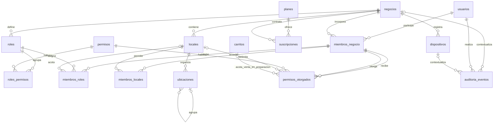
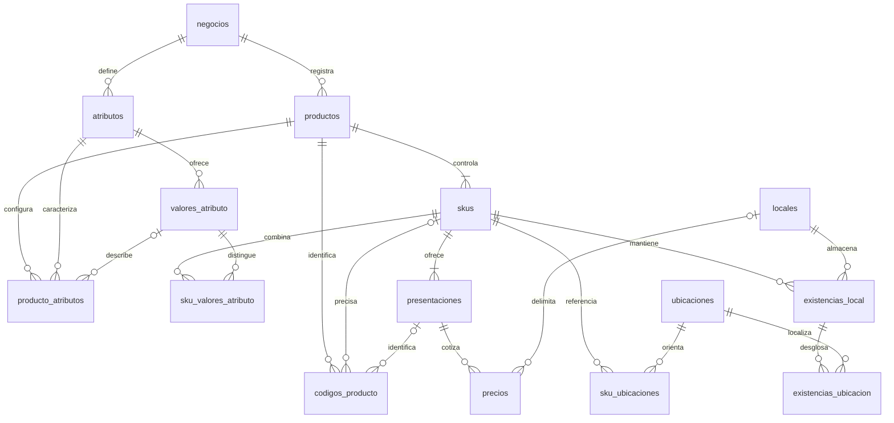
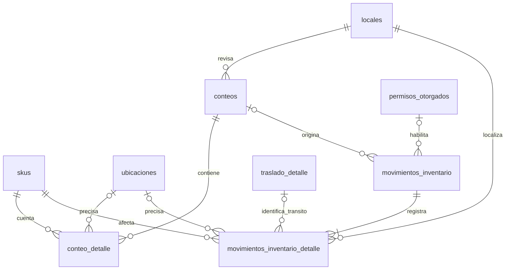
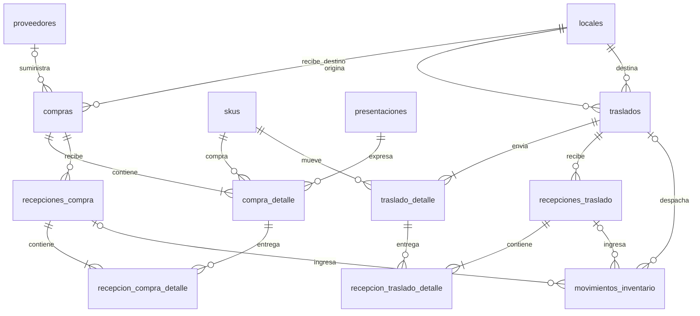
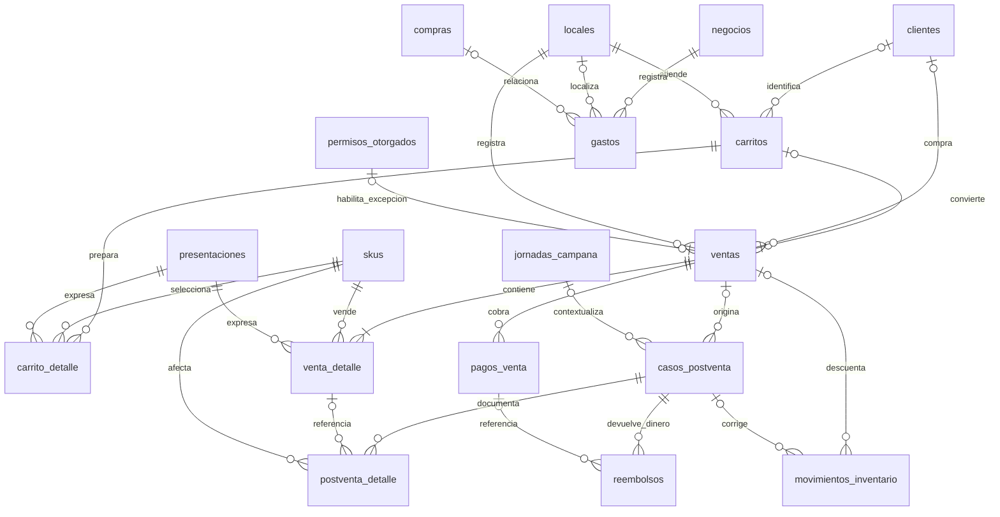
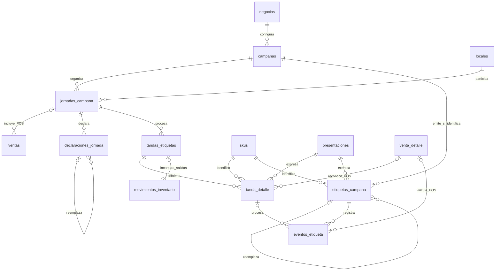
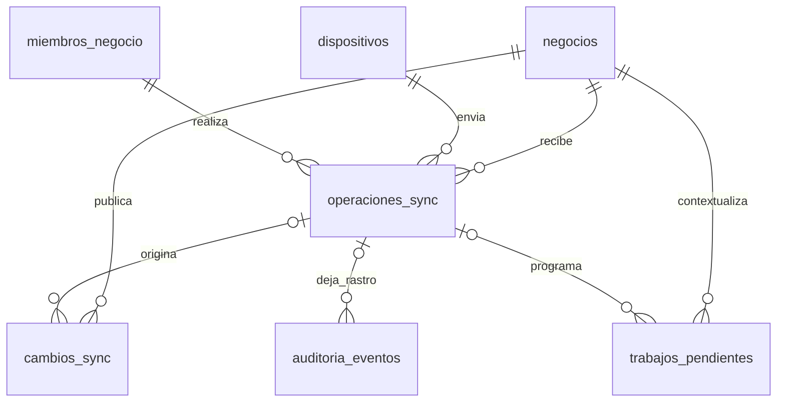

# VEXOR: modelo inicial de datos y relaciones

Fecha: 20 de octubre de 2026. Estado: **propuesta para revisión**, no esquema aprobado ni migración ejecutada.

Se propone un modelo lógico de **60 tablas propias: 58 de base y 2 condicionadas a activar identificación individual de etiquetas**. El número corresponde a esta propuesta del alcance conversado, no a un mínimo obligatorio para construir un sistema robusto. En la revisión se podrán simplificar o separar estructuras sin cambiar las reglas del negocio.

No se cuentan las tablas internas de Supabase Auth, las tablas de herramientas/migraciones, las vistas de reportes ni los almacenes locales de IndexedDB. Las 60 tablas no se copian completas al celular. Reportes y asistencia básica no necesitan por sí solos tablas adicionales en esta etapa.

La arquitectura monolítica fue confirmada. La estructura modular y las decisiones de modelado de este documento son recomendaciones. Consultar [arquitectura, consistencia y capacidad](ARQUITECTURA_MONOLITO.md) y los [acuerdos funcionales](../MEMORIA_PROYECTO.md).

## 1. Convenciones

- Un `negocio` es un tenant. `negocio_id` representa el `tenant_id` de los acuerdos existentes; usar un solo nombre consistente al implementar.
- Las tablas comerciales llevan `negocio_id`, también los detalles y puentes. Sus referencias solo pueden apuntar a registros del mismo negocio.
- `usuarios`, `permisos` y `planes` son estructuras globales con políticas de acceso propias. `negocios` es la raíz. Los eventos administrativos globales deben separarse lógicamente de los eventos de un tenant y no dar acceso transversal a trabajadores.
- `locales` reúne puestos y almacenes. Cada local puede almacenar; vender depende de su habilitación y del plan. Una ubicación es un espacio interno de un local.
- La tabla `skus` representa el artículo o variante cuya cantidad se controla por separado; no es una tabla de códigos. Un producto sin variantes tendrá un registro base, invisible como complejidad para el comerciante. El nombre técnico aún es propuesto; la interfaz puede hablar de productos y variantes. `codigos_producto` contiene los identificadores para encontrarlos.
- Cada tabla tiene identidad técnica estable. Se proponen fechas de creación y, cuando corresponda, estado y versión. Los documentos guardan autor y fechas del hecho/captura; los hechos confirmados se corrigen con trazabilidad.
- Los campos mencionados son orientativos. Se posponen DDL, tipos completos, índices y restricciones detalladas. Esto no significa omitir la integridad y el aislamiento en la implementación.
- En los diagramas, `||` significa uno obligatorio, `o|` cero o uno, y `o{` cero o muchos. Se omiten aristas repetitivas hacia negocio/autor para facilitar lectura. Los diagramas son vistas del mismo modelo.

## 2. Listado de tablas

### A. Plataforma, equipo y locales: 12 tablas

| N.º | Tabla | Finalidad y uso | Relaciones principales |
| --- | --- | --- | --- |
| 1 | `usuarios` | Perfil de la persona que usa VEXOR. Referencia la identidad de Supabase Auth; no almacena contraseñas. El acceso administrativo de plataforma se gestiona de forma protegida y separada del rol comercial. | Una identidad Auth por perfil; un usuario puede tener membresías en distintos negocios. |
| 2 | `negocios` | Raíz del tenant: nombre, estado, zona horaria y preferencias delimitadas. | Tiene miembros, locales, suscripciones y datos comerciales. |
| 3 | `miembros_negocio` | Relaciona usuario y negocio, conserva estado de acceso. El propietario también es miembro. | Usuario + negocio; se vincula con roles, locales y operaciones del trabajador. |
| 4 | `roles` | Roles del negocio: propietario, encargado, vendedor u otros que se decidan. | Negocio; permisos mediante `roles_permisos`; asignaciones mediante `miembros_roles`. |
| 5 | `permisos` | Catálogo global de acciones que entiende el backend, por ejemplo consultar costos o ajustar stock. | Relación N:M con roles. El propietario asigna permisos existentes, no inventa capacidades del servidor. |
| 6 | `roles_permisos` | Define las acciones permitidas por un rol. | Rol + permiso. Pertenece al negocio del rol. |
| 7 | `miembros_roles` | Asigna roles a miembros; puede incluir alcance a un local o al negocio según la matriz que se apruebe. | Miembro + rol y local opcional. No concede acceso fuera de los locales autorizados. |
| 8 | `miembros_locales` | Define los locales a los que un trabajador tiene acceso. | Miembro + local del mismo negocio. Se combina con el alcance de roles. |
| 9 | `planes` | Definición versionada de la oferta y sus límites configurables. Inicialmente solo se habilita el básico. | Suscripciones. No fija límites aún no acordados. |
| 10 | `suscripciones` | Vincula un negocio con su plan, vigencia, estado y condiciones aplicadas. | Negocio + plan. Conserva historial; no presupone una pasarela de cobro. |
| 11 | `locales` | Puestos y almacenes, capacidad de vender, estado y preferencias de ubicación. | Negocio; ubicaciones, trabajadores, existencias, ventas y movimientos. |
| 12 | `ubicaciones` | Estantes, vitrinas, bolsas u otros espacios reconocibles. Jerarquía opcional, sin tres niveles obligatorios. | Local; ubicación superior opcional; referencias y cantidades cuando se active modo exacto. |

**Regla de acceso propuesta:** pertenencia activa y acceso al local, combinados con un permiso del rol o una concesión individual vigente para esa acción y alcance. El propietario puede personalizar los permisos de dos trabajadores con el mismo rol, como aclaró el usuario. Las excepciones no cambian automáticamente el rol compartido ni la política general del negocio. La matriz detallada sigue pendiente.

### B. Catálogo: 9 tablas

| N.º | Tabla | Finalidad y uso | Relaciones principales |
| --- | --- | --- | --- |
| 13 | `productos` | Ficha comercial: nombre reconocible, descripción, alias y estado. Puede tener referencias a imágenes externas. | Negocio; atributos, SKU y códigos. |
| 14 | `atributos` | Características definidas por el negocio, con tipo y propósito; por ejemplo talla, color o marca. | Negocio; valores permitidos y configuración por producto. |
| 15 | `valores_atributo` | Valores de una característica, como rojo o talla M, validados según su tipo. | Atributo; asignaciones descriptivas y combinaciones de SKU. |
| 16 | `producto_atributos` | Establece qué características usa un producto y cuáles describen o separan stock. Puede guardar la selección descriptiva aplicable a toda la ficha. | Producto + atributo; valor descriptivo opcional. |
| 17 | `skus` | Unidad de control de stock: producto base o variante concreta. Guarda unidad base y precisión admitida como propuesta. | Producto; combinación de valores, presentaciones, existencias y líneas operativas. |
| 18 | `sku_valores_atributo` | Describe la combinación que distingue un SKU, sin imponer columnas de talla/color a todos los rubros. | SKU + atributo configurado + valor correspondiente. |
| 19 | `presentaciones` | Forma de comprar/vender un SKU: unidad, paquete, docena y equivalencia con la unidad base. | SKU; códigos, precios y líneas de compra/venta. No presupone paquetes mixtos. |
| 20 | `codigos_producto` | Código del fabricante o interno que identifica producto, SKU o presentación. Si solo identifica modelo, se elige la variante después. | Producto y, según nivel, SKU o presentación coherentes con él. Duplicados/ambigüedades quedan por decidir. |
| 21 | `precios` | Precio de venta de una presentación, con vigencia. El precio aplicado se copia a la venta. | Presentación; alcance por negocio o local pendiente. No se aprueban listas de precios nuevas. |

Las características descriptivas libres pueden usar metadatos validados. Los atributos que distinguen cantidades deben quedar estructurados y sus combinaciones controladas. No convertir toda la base en un modelo genérico de atributo/valor.

Si después se divide un SKU agrupado en variantes, distribuir las existencias mediante conteo o asignación explícita y conservar las referencias históricas. No inferir retroactivamente cantidades por talla o color que nunca se registraron.

### C. Inventario y conteos: 7 tablas

| N.º | Tabla | Finalidad y uso | Relaciones principales |
| --- | --- | --- | --- |
| 22 | `sku_ubicaciones` | Indica dónde buscar físicamente un SKU en el modo orientativo. No contiene cantidades sumables. | SKU + ubicación. |
| 23 | `existencias_local` | Saldo operativo por SKU y local, con estado de incorporación/conteo. Distingue cantidad desconocida de cero confirmado. | SKU + local; se actualiza junto con los movimientos. El tránsito se controla por traslado, separado del disponible local. |
| 24 | `existencias_ubicacion` | Desglose del saldo por ubicación cuando se elige control exacto. | Existencia local + ubicación del mismo local. Su suma debe cuadrar con el total, no añadirse otra vez a él. |
| 25 | `movimientos_inventario` | Cabecera de un hecho: inicial, recepción, venta, traslado, ajuste o corrección, con autor y motivo. | Documento de origen concreto: conteo, venta, recepción, postventa o tanda; autorización cuando corresponda. |
| 26 | `movimientos_inventario_detalle` | Cantidad firmada por SKU, ámbito local/tránsito y ubicación cuando corresponda. Permite reconstruir y revisar cambios. | Movimiento + SKU + local; ubicación/traslado según el hecho y detalle de origen. |
| 27 | `conteos` | Sesión de inventario inicial o verificación posterior, con alcance y avance reanudable. | Local, autor; detalles y movimiento resultante al confirmar. |
| 28 | `conteo_detalle` | Cantidad contada por SKU y, si aplica, ubicación, con referencia al corte conciliado. | Conteo + SKU; ubicación opcional. No activa todo el puesto al confirmar un producto. |

La confirmación inicial activa el SKU contado en ese local. Antes de ello, las ventas físicas se realizan fuera de VEXOR, como está acordado. Un saldo negativo puede reflejar una diferencia por ventas offline ya cobradas; no se transforma en cero ocultando el problema. Su tratamiento exige conciliación.

Los movimientos son el historial y los saldos la lectura operativa mantenida en la misma transacción. No son dos fuentes independientes que puedan editarse por separado. El modo exacto y el orientativo son alternativas de detalle, no inventarios acumulables.

### D. Traslados: 4 tablas

| N.º | Tabla | Finalidad y uso | Relaciones principales |
| --- | --- | --- | --- |
| 29 | `traslados` | Solicitud/envío de mercadería entre dos locales del negocio, con estado, responsables y salida. | Local origen + destino; detalles, recepciones y movimiento de salida. |
| 30 | `traslado_detalle` | SKU y cantidades enviadas, base para controlar lo recibido y en tránsito. | Traslado + SKU; detalles de recepción. |
| 31 | `recepciones_traslado` | Cada confirmación de llegada al destino. Separada del envío. | Traslado; responsable; movimiento de entrada. |
| 32 | `recepcion_traslado_detalle` | Cantidad efectivamente recibida de una línea enviada. | Recepción + `traslado_detalle`. Permite representar parciales; su política sigue pendiente. |

Ejemplo sin diferencias: enviar 10 deja 10 en tránsito; recibir 6 suma 6 al destino y deja 4 en tránsito. El total del negocio no aumenta por mover mercadería. Cantidades faltantes no desaparecen al cerrar un estado; requieren resolución autorizada.

### E. Compras: 5 tablas

| N.º | Tabla | Finalidad y uso | Relaciones principales |
| --- | --- | --- | --- |
| 33 | `proveedores` | Referencia sencilla de quien vende mercadería al negocio. Datos mínimos pendientes, sin exigir comprobante. | Negocio; compras. |
| 34 | `compras` | Registro interno de compra, fecha, proveedor opcional, moneda y comprobante opcional. | Local destino, proveedor y autor; líneas y recepciones. |
| 35 | `compra_detalle` | SKU, presentación, equivalencia y cantidad comprada, costo conocido o pendiente. | Compra + SKU + presentación. Guarda las condiciones históricas. |
| 36 | `recepciones_compra` | Llegada física de mercadería; puede coincidir con la compra en una misma acción de interfaz. | Compra + local receptor; movimiento de ingreso. |
| 37 | `recepcion_compra_detalle` | Cantidad recibida de cada línea de compra. | Recepción + `compra_detalle`. No duplica el ingreso al volver a abrir el documento. |

Esta separación no aprueba órdenes de compra, cuentas por pagar ni crédito a proveedores. El pago de compras y su relación con gastos requieren precisar qué se registrará; costo de adquisición e ingreso físico no son por sí solos una salida de efectivo.

### F. Venta, clientes y postventa: 9 tablas

| N.º | Tabla | Finalidad y uso | Relaciones principales |
| --- | --- | --- | --- |
| 38 | `clientes` | Ficha opcional de comprador frecuente dentro del negocio. No es un usuario del sistema. | Negocio; ventas. Nombre/teléfono/DNI se ajustarán a los mínimos acordados. |
| 39 | `carritos` | Atención en curso o en espera, trabajador, local y cliente opcional. | Local + miembro; cliente opcional; detalles. No reserva ni descuenta stock. |
| 40 | `carrito_detalle` | Productos, presentación, cantidad y propuesta de importe durante la atención. | Carrito + SKU + presentación. Cambios compartidos requieren control de versión. |
| 41 | `ventas` | Hecho de venta: local, autor, cliente opcional, subtotal, descuento, total, estado y fechas. | Carrito de origen opcional; líneas y pagos; autorización cuando proceda; jornada de campaña opcional con alcance validado. |
| 42 | `venta_detalle` | SKU vendido, cantidad base y presentación; copias de descripción, equivalencia y precio aplicados. | Venta + SKU + presentación; movimientos, etiquetas y postventa. |
| 43 | `pagos_venta` | Partes del pago: efectivo, Yape o Plin, importe aplicado y, en efectivo, entregado/vuelto. | Venta. Permite varios medios; no identifica titular del QR ni verifica al banco. |
| 44 | `casos_postventa` | Cambio, devolución o corrección con estado, motivo y autorizaciones. | Venta original cuando exista; jornada de campaña si no hay venta individual; nueva venta asociada si la política la requiere; detalles, movimientos y reembolsos. |
| 45 | `postventa_detalle` | Lo que se recibe, entrega o corrige, con SKU, cantidad y condición. La condición orienta el tratamiento pendiente. | Caso + línea original cuando aplique + SKU/presentación. No reincorpora automáticamente productos defectuosos. |
| 46 | `reembolsos` | Salida de dinero autorizada por una postventa, con medio e importe. | Caso de postventa y pago original cuando se pueda identificar. La política de devolución aún debe definirse. |

**Ejemplo de pago mixto:** total S/50; Yape aplicado S/40; efectivo aplicado S/10; entregado S/20 y vuelto S/10. El ingreso es S/50, no S/60. Un descuento indicado como total final o rebaja en soles representa la misma negociación, no dos descuentos acumulables.

La estructura permite estados pendientes; no aprueba vender a crédito ni dejar cobros parciales abiertos. Hasta definirlos, la operación normal completa la venta con el total cubierto. No se incorporan apertura, cierre ni arqueo de caja.

En una campaña puede no existir la venta individual original. El modelo no obliga a inventarla para tramitar una postventa: conserva la jornada y la evidencia disponible. Las condiciones para admitir ese caso, identificar lo entregado y autorizar sus efectos siguen pendientes; esta relación no aprueba devoluciones sin control.

### G. Gastos: 1 tabla

| N.º | Tabla | Finalidad y uso | Relaciones principales |
| --- | --- | --- | --- |
| 47 | `gastos` | Registro de una salida de dinero del negocio con motivo, importe, medio, fecha y responsable. Categoría inicial configurable sin módulo contable completo. | Negocio; local opcional; compra relacionada si se define ese flujo. No vuelve a registrar un reembolso como otro egreso independiente. |

### H. Campañas: 7 tablas, 2 condicionadas

| N.º | Tabla | Finalidad y uso | Relaciones principales |
| --- | --- | --- | --- |
| 48 | `campanas` | Configuración opcional del trabajo de campaña: nombre, período, modalidades y alcance. | Negocio; jornadas. Alcance exacto por local/rubro/producto pendiente. |
| 49 | `jornadas_campana` | Jornada y local cuyo total y salidas se concilian, con fecha comercial independiente de la captura. | Campaña + local; ventas POS, declaraciones y tandas. Evitar alcances superpuestos en reportes. |
| 50 | `declaraciones_jornada` | Versiones del total vendido declarado para la jornada, responsable y motivo de corrección. | Jornada; declaración anterior opcional. El total incluye POS y todos los medios; desglose pendiente. |
| 51 | `tandas_etiquetas` | Sesión reanudable de procesamiento posterior con avance, responsable y estado. | Jornada; detalles y movimientos de salidas aún no registradas. |
| 52 | `tanda_detalle` | SKU/presentación, cantidad procesada y origen: pendiente de salida o ya registrada en POS. Correcciones conservan referencia al asiento corregido. | Tanda + SKU/presentación; línea POS cuando exista evidencia; movimiento solo para la salida pendiente. |
| 53 | `etiquetas_campana` | **Condicional.** Identidad propia de una etiqueta para detectar repeticiones, anular o reemplazar. No es una nueva unidad de stock. | Campaña + SKU/presentación; etiqueta reemplazada opcional. Se usa solo si se activa identificación individual. |
| 54 | `eventos_etiqueta` | **Condicional.** Historial de emisión, procesamiento, vínculo POS o invalidación de una etiqueta identificable. | Etiqueta; detalle de tanda o venta según evento; autor. Permite verificar que no cause otra salida. |

En captura agrupada no se exige crear filas individuales de etiquetas. La cantidad impresa, emitida o reimpresa no modifica existencias. Las tablas 53 y 54 no convierten toda la mercadería en inventario serializado.

**Dinero y mercadería son dos ejes:**

- Si se declara S/15 000 y el POS ya contiene S/2 000 de ese mismo alcance, el total sigue siendo S/15 000. S/13 000 es importe no detallado individualmente, no otra venta a sumar por encima del total.
- Procesar etiquetas pendientes registra cantidades de salida, sin inventar precios efectivos, descuentos ni pagos individuales.
- Etiquetas correspondientes a ventas POS no vuelven a descontar. Sin identificación individual ni vínculo verificable, la separación física y el procedimiento de conciliación siguen siendo necesarios.
- Si los datos POS exceden el total declarado o hay alcances dudosos, señalar discrepancia. No ajustar automáticamente cifras para forzar coincidencia.
- Antes de confirmar un conteo, resolver qué salidas ya están comprendidas en él y cuáles siguen pendientes. La estructura conserva referencias, pero el algoritmo y el procedimiento operativo aún deben acordarse.

### I. Permisos otorgados, auditoría y dispositivos: 3 tablas

| N.º | Tabla | Finalidad y uso | Relaciones principales |
| --- | --- | --- | --- |
| 55 | `permisos_otorgados` | Concesión individual creada por el propietario, adicional al rol: acción habilitada, alcance, inicio, vencimiento editable y revocación. Registra el permiso concedido; no presupone solicitudes ni aprobaciones dentro de la aplicación. | Miembro receptor + permiso + miembro otorgante del mismo negocio; local o contexto de venta cuando corresponda. La venta aplicada conserva la referencia a la concesión. |
| 56 | `auditoria_eventos` | Rastro de operaciones y correcciones relevantes, con responsable, negocio, acción, recurso e identificador de operación. | Miembro/usuario + dispositivo/operación cuando corresponda. Metadatos delimitados; sin contraseñas ni tokens. |
| 57 | `dispositivos` | Registro de instalación/contexto de sincronización autorizado para un negocio. Identificador lógico, estado y última comunicación. | Negocio; usuario que lo registra y operaciones. No es prueba de identidad ni exige identificador físico del teléfono. |

El usuario confirmó permisos particulares por trabajador y concesiones con vencimiento administrable por el propietario. Un descuento excepcional se limita a la venta concreta; no habilita cambiar el límite general. El permiso temporal para ajustar existencias habilita esa acción durante su vigencia y alcance, conservando el ajuste y su responsable.

**Detalles propuestos para el diseño físico:** conservar motivo, revocación, límites de la excepción y uso de la concesión. Para una venta todavía no confirmada, vincular la concesión a un carrito existente o a una venta en preparación, y después al resultado confirmado; no crear una referencia obligatoria a una venta inexistente. La modalidad exacta queda por elegir. Se recomienda que una excepción de venta sea de un solo uso, consumida en la misma transacción que la venta; ese mecanismo aún no está aprobado.

Vencer o revocar una concesión elimina el acceso adicional, no los permisos que el rol todavía otorgue. La vigencia se comprueba al ejecutar la acción; no depende de que una tarea programada cambie su estado. El uso offline y el caso de una operación enviada después del vencimiento necesitan una política explícita.

### J. Sincronización y ejecución durable: 3 tablas

| N.º | Tabla | Finalidad y uso | Relaciones principales |
| --- | --- | --- | --- |
| 58 | `operaciones_sync` | Recepción idempotente: clave de operación, huella del contenido, autor, dispositivo, versión de contrato, resultado y estado de revisión. | Negocio + dispositivo + miembro; referencia al hecho aplicado. También puede cubrir comandos online reintentables. |
| 59 | `cambios_sync` | Registro de cambios confirmados y bajas para descargas incrementales autorizadas. Cursor/orden y retención por definir. | Negocio + recurso cambiado + operación de origen cuando exista. No expone automáticamente todo el contenido de la fila. |
| 60 | `trabajos_pendientes` | Trabajo posterior durable con tipo, contenido delimitado, estado, intentos y próxima ejecución. | Negocio/contexto autorizado + hecho origen. Se guarda en la transacción de origen; se ejecuta con permiso vigente e idempotencia. |

Los recursos genéricos de auditoría/sincronización se identifican por tipo e ID; son referencias de trazabilidad, no reemplazos de las relaciones comerciales. Las relaciones venta→pagos, compra→recepciones o traslado→recepciones sí deben tener integridad referencial real.

## 3. Resumen del conteo

| Grupo | Tablas |
| --- | ---: |
| Plataforma, equipo y locales | 12 |
| Catálogo | 9 |
| Inventario y conteos | 7 |
| Traslados | 4 |
| Compras | 5 |
| Venta, clientes y postventa | 9 |
| Gastos | 1 |
| Campañas | 7 |
| Permisos otorgados, auditoría y dispositivos | 3 |
| Sincronización y ejecución durable | 3 |
| **Total propuesto** | **60** |

## 4. Modelo entidad-relación por áreas

### Identidad, negocio y control

`usuarios.auth_user_id` referencia la identidad externa administrada por Supabase Auth, no contada aquí. Toda operación comercial identifica al miembro del negocio que la realiza. Una persona puede pertenecer a varios negocios sin compartir sus datos.

El negocio de `auditoria_eventos` solo es opcional para eventos administrativos de plataforma. Una acción comercial siempre tiene negocio. El autor automatizado requiere identidad de servicio explícita en el diseño físico, sin atribuirlo falsamente a un trabajador.

### Catálogo y representación del stock

Las cardinalidades producto→SKU y SKU→presentación corresponden a fichas listas para operar; los borradores pueden estar incompletos. El alcance local de precios es una posibilidad del modelo, pendiente de aprobación. Un código tiene un nivel de resolución coherente; las aristas opcionales no autorizan combinaciones contradictorias.

### Conteos y movimientos

Los orígenes de los movimientos aparecen también en los diagramas siguientes. Se propone un origen comercial principal por movimiento y una referencia a la corrección cuando corresponda. Que se dibujen varias relaciones opcionales no permite vincular un movimiento simultáneamente a documentos de origen incompatibles.

### Compras y traslados

Origen y destino son dos referencias distintas a `locales`. Las recepciones parciales y correcciones tienen identidad propia para deduplicarlas. Los diagramas representan documentos operativos confirmados; sus borradores pueden no tener líneas todavía.

### Ventas, dinero y postventa

Una venta directa puede no tener carrito persistido. Un carrito origina como máximo una venta; se debe reforzar esa regla en la confirmación para evitar dobles clics o conversiones desde dos dispositivos. Los reembolsos no se vuelven a sumar como gastos independientes. No hay relaciones obligatorias a clientes ni a un titular de QR.

### Campañas y etiquetas

El total declarado pertenece a la jornada y su alcance; las etiquetas pertenecen al control de mercadería. No se genera una venta individual ficticia para cada etiqueta. El protocolo debe conciliar ventas tardías/offline y evitar que una venta cambie de alcance para contarse dos veces.

### Sincronización y trabajos

Un cambio o trabajo puede nacer de una operación del servidor sin registro previo en `operaciones_sync`; conserva su origen y contexto autorizado. Los tipos de recurso y tarea no permiten ejecutar instrucciones arbitrarias suministradas por el celular.

## 5. Recorridos de comprobación del modelo

| Caso | Registros principales y resultado esperado |
| --- | --- |
| Incorporar producto sin variantes | Producto → SKU base → presentación unidad → precio. El saldo sigue pendiente hasta confirmar el conteo de ese SKU/local. |
| Vender una docena | Presentación con equivalencia 12; vender 2 descuenta 24 unidades base. La línea conserva esa equivalencia aunque se cambie después el catálogo. |
| Cobrar y confirmar | Una transacción guarda venta, líneas, pagos, movimiento, saldo y deduplicación. El carrito no había descontado antes. |
| Cambiar talla | Caso de postventa con línea recibida y entregada; movimientos según autorización y condición. Diferencia de importe y política de defectuosos siguen abiertas. |
| Trasladar parcialmente | Envío conserva lo despachado; cada recepción identifica la cantidad de su línea. Pendiente en tránsito = enviado menos recibido y resoluciones justificadas. |
| Procesar campaña | Jornada con total declarado y ventas POS; tandas incorporan únicamente salidas pendientes. Las capturas no crean ingresos adicionales. |
| Reintentar venta offline | Misma clave y contenido recuperan el resultado confirmado. No se repite venta, pago ni movimiento. |
| Consultar resultados | Ventas y declaraciones se concilian por alcance; pagos muestran medios efectivamente registrados; costos desconocidos impiden presentar ganancia completa. |

## 6. Lo que no queda decidido por esta propuesta

1. La aprobación final de las 60 tablas, sus campos, nombres, índices o restricciones físicas.
2. La matriz exacta de roles y concesiones por trabajador; alcance por local; identificación de la venta en preparación; consumo único propuesto y funcionamiento de permisos temporales offline. La personalización individual, el vencimiento editable y el descuento excepcional limitado a una venta ya están aclarados por el usuario.
3. La forma de conciliar un conteo con ventas, traslados y etiquetas pendientes. Confirmar un saldo sin ese corte puede provocar doble descuento.
4. Los mínimos del producto/cliente y las reglas de códigos, características, precios por local y cambio entre modos de ubicación.
5. Cobros parciales, anulaciones, diferencias de precio en cambios y tratamiento de defectuosos/reembolsos.
6. La estrategia de costos, valorización y cálculo de ganancias. El costo histórico de compra no determina por sí solo el costo de cada venta.
7. Activar las dos tablas de identidad individual de etiquetas; la captura agrupada sigue siendo posible sin ellas.
8. El desglose de campaña por medio de pago y su conciliación con las ventas POS. No se deduce a partir del precio impreso.
9. El alcance de venta por peso, fracciones, lotes, vencimientos o paquetes mixtos. El catálogo adaptable no demuestra que esos flujos estén implementados.
10. La modalidad comercial de cobro del servicio y sus límites; no se aprueban planes adicionales, facturación electrónica ni contabilidad completa.
11. ORM, protocolo físico de sincronización, retención, recuperación, proveedor de IA/archivos y dimensionamiento de producción.

Propuesta de revisión: primero negocio/miembros/locales y producto/SKU/presentación; después inventario/operaciones; finalmente campañas, sincronización y permisos de excepción. Resolver las decisiones que cambien relaciones antes de escribir migraciones y pasar al demo.

Consultar [preparación para implementar](PREPARACION_IMPLEMENTACION.md) para distinguir el trabajo pendiente antes de las primeras migraciones del que puede resolverse por módulo.
