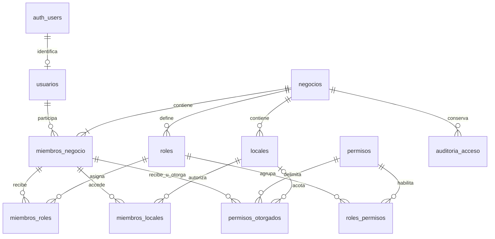

# Núcleo de base de datos — bloque 1

Fecha: 20 de octubre de 2026. Alcance: base de datos; el backend HTTP y la PWA continúan en el siguiente bloque.

## Reglas del usuario y decisiones técnicas

Confirmado en esta conversación: un negocio puede tener varios copropietarios; los trabajadores requieren locales asignados; los propietarios acceden a todos los locales del negocio. Los permisos individuales pueden añadir acciones o quitar acciones concedidas por el rol.

Decisiones técnicas de este bloque: propietario es una condición protegida de la membresía, no un rol editable. Se conserva al menos una membresía propietaria activa por negocio. Una denegación vigente prevalece sobre roles y concesiones individuales. Los propietarios mantienen las capacidades de administración necesarias para gestionar accesos. No se crean matrices predeterminadas de vendedor/encargado/administrador que todavía no estén definidas.

Se conserva el monolito NestJS/TypeScript, PostgreSQL en Supabase y Supabase Auth. React/Vite, Dexie y la venta offline siguen en su alcance acordado; este bloque no implementa sus flujos.

## Persistencia y migraciones

- **Kysely + `pg`**: consultas TypeScript y transacciones sobre una conexión PostgreSQL. No se incorpora otro servidor ni servicio.
- **SQL versionado en `supabase/migrations`**, ejecutado por Supabase CLI. Una única autoridad para DDL, restricciones, funciones y RLS; no se usa el migrador de Kysely ni sincronización automática de esquemas.
- PostgreSQL 17 como base compatible, comprobada con PostgreSQL 17.11 y Supabase.
- UUID generables también por clientes futuros y `timestamptz` para instantes. La zona horaria del negocio es un nombre válido del catálogo IANA de PostgreSQL; valor inicial `America/Lima`.
- La migración inicial se aplica como una transacción. Una vez aplicada en un entorno compartido, las correcciones se escriben en nuevas migraciones.

`20261020000200_runtime_migraciones.sql` permite a `postgres` asumir `vexor_runtime` para probar RLS en Supabase. Es necesario porque el administrador de Supabase tiene BYPASSRLS pero no es superusuario, y crear el rol no garantiza el permiso SET ROLE. La relación no concede acceso administrativo al runtime y no crea un login nuevo.

Kysely se eligió por su acceso directo a transacciones y SQL PostgreSQL sin duplicar el esquema de migraciones en un ORM. El adaptador está en `src/database/database.ts`; todavía no es un módulo HTTP de NestJS.

Fuentes técnicas: [RLS de PostgreSQL 17](https://www.postgresql.org/docs/17/ddl-rowsecurity.html), [migraciones de Supabase](https://supabase.com/docs/guides/deployment/database-migrations), [API de Kysely](https://kysely-org.github.io/kysely-apidoc/classes/Kysely.html).

## Modelo físico y relaciones

El DDL completo y ejecutable está en `supabase/migrations/20261020000100_nucleo.sql`. Son **11 tablas propias**; el total de 60 del modelo global continúa siendo una propuesta revisable.

| Tabla en `app` | Identidad y datos principales | Integridad y acceso |
| --- | --- | --- |
| `usuarios` | UUID; `auth_user_id` UUID único; nombre, activo, fechas | FK restrictiva a `auth.users`; sin contraseñas ni copia del correo. Una persona puede pertenecer a varios negocios. Perfil propio y perfiles del equipo autorizado. |
| `negocios` | UUID; nombre, activo, zona horaria, versión, fechas | Raíz del tenant. Nombre/zona editables con permiso; estado de servicio reservado a administración. La membresía activa permite consultar el contexto básico del negocio. |
| `miembros_negocio` | UUID; negocio, usuario, `es_propietario`, activo, fechas | Un usuario por negocio; `(negocio_id,id)` único. Propiedad múltiple y comprobación diferida de al menos un propietario activo. |
| `locales` | UUID; negocio, nombre, `habilitado_venta`, activo, fechas | Todo local puede almacenar. Índice único parcial: como máximo uno activo habilitado para vender por negocio mientras solo exista el básico. Sin límite inventado de almacenes. |
| `roles` | UUID; negocio, nombre, activo, fechas | Nombre normalizado único por negocio; desactivable. No existe un rol comercial con privilegios administrativos de plataforma. |
| `permisos` | Código de acción como PK; alcance `negocio`/`local`, descripción | Catálogo global mantenido por migraciones. Un propietario no crea acciones ejecutables nuevas. |
| `roles_permisos` | PK negocio + rol + permiso | FK compuesta al rol del mismo negocio; FK al catálogo global. |
| `miembros_roles` | UUID; negocio, miembro, rol, local opcional, fecha | FKs compuestas a miembro/rol/local. Unicidad incluso con local nulo. Un rol con alcance local no otorga acciones de negocio. |
| `miembros_locales` | PK negocio + miembro + local; fecha | FKs compuestas. Una asignación de rol o permiso nunca sustituye la asignación del local. |
| `permisos_otorgados` | UUID; negocio, miembro, acción, `permitir`/`denegar`, local opcional, inicio, vencimiento, revocación, otorgante, motivo, fechas | Destinatario, otorgante y local del mismo negocio. Intervalos válidos y fin opcional. Otorgante real comprobado. Identidad, destinatario y alcance inmutables: para cambiarlos se revoca y crea otra concesión. |
| `auditoria_acceso` | UUID; negocio, actor Auth, sesión SQL, tabla/operación, antes/después JSONB, instante | Registro transaccional de cambios del núcleo. Solo lectura para propietarios, sin escritura o borrado desde runtime. No reemplaza la futura auditoría comercial. |

Nombres obligatorios no vacíos y con longitudes acotadas. Identidades y negocio no se cambian por UPDATE. Las FKs comerciales siempre incluyen `negocio_id`; los índices siguen búsquedas por negocio/miembro/local y las referencias relevantes.



Para módulos posteriores: productos/SKU dependen del negocio; existencias y documentos usan locales y miembros mediante FKs compuestas. Ubicaciones internas, planes/suscripciones, inventario, ventas y dispositivos no se implementan todavía. No se agregan referencias ficticias a ventas inexistentes ni JSON genérico para sustituirlas. La excepción de descuento por venta y su eventual consumo único se resolverán en ese bloque.

## Autorización y aislamiento

1. NestJS validará el JWT de Supabase Auth. El `sub` verificado es el actor; el cuerpo de la petición no decide la identidad.
2. `withTenant` abre una transacción, rechaza cuentas administrativas, ejecuta `SET LOCAL ROLE vexor_runtime` y fija `vexor.actor_id` y `vexor.negocio_id` con `set_config(..., true)` y parámetros.
3. La base comprueba usuario, negocio y membresía activos. Un UUID de negocio solicitado no concede acceso.
4. Para una acción local se exige local activo, perteneciente al negocio y asignado al trabajador. El propietario no necesita asignación. Se evalúa denegación individual, concesión individual y roles activos.
5. Una excepción global de una acción local se aplica solo a los locales ya autorizados. La denegación gana aunque otra concesión coincida. Vencer/revocar una concesión no elimina un permiso independiente que el rol todavía conceda.
6. Inicio y vencimiento se comparan con la hora del servidor al evaluar la acción, incluso dentro de transacciones largas. No se necesita un proceso programado para expirar permisos.
7. Al confirmar o revertir desaparecen contexto y rol locales. Todas las consultas del caso de uso deben usar el `tx` recibido; no el pool global.

Los esquemas `app` y `app_private` no se exponen por la API de datos. `anon`, `authenticated` y `service_role` no reciben uso del esquema ni ejecución de helpers. Las once tablas tienen RLS habilitado y forzado. El rol `vexor_runtime` no tiene login, BYPASSRLS, propiedad de tablas, creación de roles ni capacidades administrativas. Los helpers `SECURITY DEFINER` tienen `search_path` vacío, nombres cualificados, sin SQL dinámico y permisos de ejecución delimitados.

La cuenta SQL del futuro backend debe ser LOGIN, NOINHERIT, NOSUPERUSER, NOBYPASSRLS, NOCREATEDB, NOCREATEROLE, NOREPLICATION y miembro únicamente de `vexor_runtime`. Su contraseña se configura fuera del repositorio al desplegar NestJS. No se ha creado una contraseña ni cuenta de servidor remota anticipada. El `postgres` de migraciones y las credenciales de Supabase no se utilizan para el tráfico de la aplicación.

**Frontera de confianza:** la conexión del servidor puede fijar actor/contexto porque NestJS ya verificó la identidad. RLS no valida JWTs por sí sola ni protege contra un servidor comprometido que suplante actores. Los clientes no reciben esta conexión. La administración de VEXOR todavía necesita un flujo de aprovisionamiento restringido, separado del runtime comercial; no se ha concedido acceso comercial implícito al administrador de plataforma.

Se siembran solo cuatro acciones del núcleo: `negocio.editar`, `equipo.ver`, `locales.ver`, `locales.gestionar`. La gestión de miembros, roles y excepciones sigue reservada al propietario. Los demás trabajadores pueden recibir acciones existentes; no se aprueba por ello una matriz comercial predeterminada. Crear un local corresponde al propietario; la edición delegada requiere permiso y local asignado. El archivo de auditoría es exclusivo de propietarios.

## Bajas y límites conservados

El runtime no borra negocios, usuarios, miembros, roles, locales ni excepciones: permite desactivación/revocación según sus privilegios y conserva referencias. Puede quitar asignaciones de roles/locales/permisos de rol, con auditoría. No hay purga o plazo de conservación comercial implementados. La suspensión de negocio y usuario es una operación administrativa, no una capacidad editable por el comerciante.

La baja de un propietario escribe la raíz del negocio y comprueba al confirmar que queda otro propietario activo. La escritura en la raíz serializa bajas concurrentes; en aislamiento repetible, un conflicto puede exigir reintentar la transacción completa.

El básico habilita un puesto activo y almacenamiento; no obliga a que el alta nazca con locales ficticios ni limita el almacén a un solo registro. La futura contratación de mayor capacidad sustituirá el índice parcial mediante una migración y reglas de suscripción definidas. No se crean planes adicionales.

## Verificación reproducible

```powershell
npm ci
npm run typecheck
npm run db:test
npm run db:test:postgres
```

`db:test` crea PostgreSQL embebido desechable con PGlite y aplica las migraciones desde cero. `db:test:postgres` crea un contenedor propio PostgreSQL 17 con puerto aleatorio solo en `127.0.0.1`, contraseña aleatoria y sin volúmenes; lo retira al terminar. Necesita Docker activo. El archivo `tests/db/bootstrap.sql` simula exclusivamente las dependencias Auth/roles en estas bases vacías; **no debe ejecutarse en Supabase**, que ya las administra.

`tests/db/nucleo.sql` ejecuta 71 comprobaciones de FKs, unicidad, vigencias, concesiones/denegaciones, copropiedad, RLS, escalada de privilegios, estado de acceso y auditoría. Termina en ROLLBACK y comprueba además que el contexto no queda en una conexión reutilizada. La misma suite sirve en Supabase desarrollo; los datos Auth ficticios también se revierten.

PostgreSQL añade dos carreras de bajas de propietarios (READ COMMITTED y REPEATABLE READ) y una integración real Kysely/pg con login restringido y pool de una conexión: acceso autorizado, cuenta administrativa rechazada, permiso ausente, tenant sin membresía, rollback de cambios y limpieza del contexto.

Los resultados detallados se generan en `test-results/` y no se versionan. No se declaran probados JWTs, endpoints HTTP, carga, operación offline ni restauración de respaldos: pertenecen a los siguientes bloques.

## Aplicación en desarrollo y continuación

Proyecto: `vexor-dev`, referencia `xlkuqntkxzwayyxovoxy`, PostgreSQL 17.11, región Oregon, API de datos desactivada. [Dashboard](https://supabase.com/dashboard/project/xlkuqntkxzwayyxovoxy).

Las dos migraciones fueron aplicadas y la suite SQL pasó también en ese proyecto. Consultar el [registro de verificación y evidencia](../verificacion/NUCLEO_2026-10-20.md) para resultados, huellas y distinción entre pruebas locales y remotas.

Para siguientes migraciones mediante CLI:

```powershell
npx supabase login
npx supabase link --project-ref xlkuqntkxzwayyxovoxy
npx supabase db push --dry-run
npm run db:migrate
```

Las credenciales se introducen fuera del código. No usar `db reset --linked` sobre un entorno con información que deba conservarse. `db:reset` es local.

Cuando la única autorización disponible es la sesión del Dashboard, `scripts/prepare-dashboard-deploy.ts` prepara el mismo archivo SQL y registra `version`, `name` y el texto completo en `supabase_migrations.schema_migrations` dentro del mismo commit. Protege también ese historial con RLS forzado y sin acceso de roles API/runtime. Normaliza los saltos CRLF del portapapeles de Windows a LF para comparar SHA-256 con el archivo local. No mantiene un segundo esquema o juego de migraciones. La salida de despliegue queda en `test-results/`, no en una nueva migración.

Para repetir únicamente la suite remota desde terminal, establecer `MIGRATION_DATABASE_URL` y `VEXOR_TEST_TARGET=development`, y ejecutar `npm run db:test:remote`. También puede ejecutarse el archivo de pruebas en el SQL Editor de este proyecto. No ejecutar el bootstrap de pruebas en remoto.

Siguiente bloque: integrar NestJS con JWT validado, listado/selección de membresías, aprovisionamiento de negocios e identidades, cuenta SQL restringida, servicios y endpoints de equipo/locales/permisos, y pruebas HTTP. Después, acceso y primeras pantallas del demo. La caducidad offline, excepciones de venta, retención comercial y matriz de roles de otros módulos se resolverán antes de activar sus funciones.
