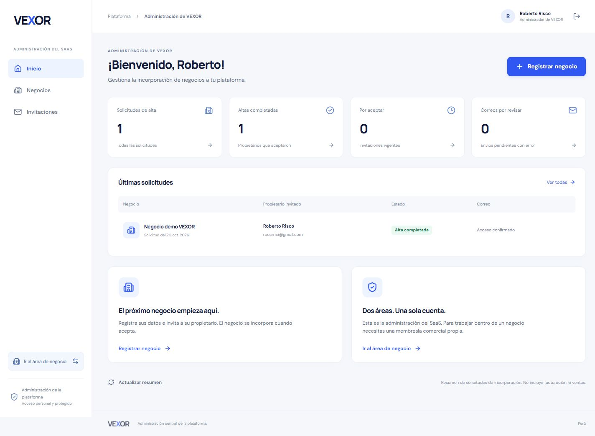
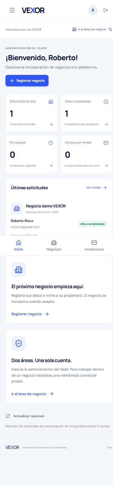

# Dos áreas: VEXOR y negocio

20 de octubre de 2026, ampliación del frontend en `codex/frontend-nucleo`.

## Implementación

La administración del SaaS tiene dashboard y navegación propios en `/plataforma`, separados del área comercial. Una sesión que `/me` reconoce como administradora abre primero esa área al entrar por `/` o iniciar sesión normalmente. Una cuenta comercial abre `/negocios`. La sesión, correo y contraseña siguen siendo únicos.

El cambio de área está visible en el lateral de escritorio y en una barra móvil, además del menú. En el negocio, el vínculo se muestra como propietario/miembro, no como administrador del SaaS. Administrar VEXOR no concede membresías comerciales.

El área SaaS contiene:

- Resumen real de solicitudes de alta, altas completadas, invitaciones vigentes y correos pendientes con error.
- Negocios incorporados mediante invitación, sin afirmar que son un censo general de negocios activos.
- Listado de invitaciones con búsqueda y filtros por estado.
- Registro de un negocio por invitación, revisión previa del destinatario y reintento con clave de idempotencia conservada por identidad.
- Reenvío y revocación con confirmación explícita. La respuesta diferencia solicitud guardada y aceptación del correo por el proveedor.

Se reutilizaron los endpoints y la autorización existentes; no se cambiaron tablas, políticas ni reglas del backend. Suscripciones, facturación, soporte, analítica e impersonación comercial no se implementaron en esta ampliación.

## Verificación

| Comprobación                   | Resultado                                                                                                                                                     |
| ------------------------------ | ------------------------------------------------------------------------------------------------------------------------------------------------------------- |
| TypeScript                     | Servidor y frontend correctos.                                                                                                                                |
| Vite de producción             | Compilación correcta.                                                                                                                                         |
| Suite frontend                 | 20 pruebas correctas: 13 anteriores y 7 nuevas de rutas por autorización, estados de invitaciones y reintentos tras recarga.                                  |
| Separación de permisos         | Una cuenta comercial recibe acceso denegado en `/plataforma` y no monta el proveedor de datos de administración. El backend sigue comprobando toda operación. |
| Sesión real en vexor-dev       | El inicio resuelve `/plataforma`; muestra la única alta demo completada, permite pasar al área comercial y volver sin otra autenticación.                     |
| Cuenta comercial en demo local | Al iniciar sesión entra a `/negocios`; la navegación no ofrece administración y una URL directa de plataforma queda denegada.                                 |
| Alta en demo local             | Revisión de nombre/correo, solicitud enviada al proveedor Auth simulado y aparición en el listado real de la base desechable. No se envió correo real.        |
| Revocación en demo local       | Confirmación visible; la invitación ficticia cambia a revocada y presenta el resultado sin volver a enviar correos.                                           |
| Responsive                     | Administración real revisada en escritorio y celular; captura de ambos tamaños y comprobación de anchura sin desbordamiento.                                  |

La regresión del backend de 98 comprobaciones está documentada en la entrega anterior. En esta ampliación no se modificó su código ni se volvió a ejecutar esa suite. La verificación de la administración usa las respuestas de los endpoints existentes.

## Evidencia

## Continuación

El siguiente paso sigue siendo configurar SMTP personalizado, desplegar un preview de Vercel y probar la PWA instalada en un teléfono. El área de administración inicial ya existe; el resto de módulos se implementará por bloques. No se añadieron identidades, negocios ni envíos reales durante estas pruebas: se leyó la demo ya autorizada y las mutaciones se probaron en PostgreSQL/Auth desechables.

[Diseño y rutas](../diseno/FRONTEND_NUCLEO.md). [Verificación del primer bloque](FRONTEND_2026-10-20.md).
