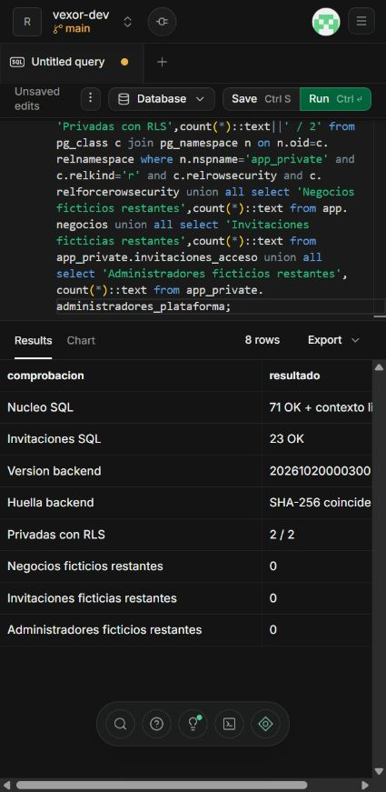
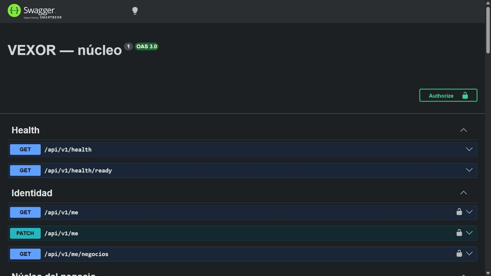

# Verificación del backend del núcleo — 20 de octubre de 2026

Rama: `codex/backend-nucleo`. Backend NestJS 11 con PostgreSQL, Kysely/pg y Supabase Auth. Las pruebas se ejecutaron con Node.js 22.17.1.

## Resultados comprobados

| Prueba | Resultado |
| --- | --- |
| TypeScript y compilación de NestJS | Correctos. |
| SQL del primer bloque | 71 comprobaciones y contexto limpio, correctos. |
| SQL de invitaciones/administración | 23 comprobaciones correctas. |
| SQL real y carreras de copropiedad | Ambas suites y READ COMMITTED / REPEATABLE READ correctos. Se comprobó que existía contención real entre conexiones. |
| Kysely/pg | Cuenta sin privilegios, rollback y limpieza de actor/correo/tenant correctos. |
| HTTP e integración | 98 comprobaciones correctas contra PostgreSQL 17.10 nativo de Windows. |
| Supabase desarrollo | Migración `20261020000300_backend_acceso` aplicada en PostgreSQL 17.11; las mismas 71 + 23 comprobaciones SQL correctas. |
| Integridad del despliegue | SHA-256 remota coincide con el archivo versionado. |
| Limpieza remota | Cero negocios, invitaciones o administradores ficticios restantes. |
| Conexión del backend a desarrollo | Cuenta `vexor_backend` creada; LOGIN sin herencia, superusuario, BYPASSRLS, creación de roles/bases ni replicación. Únicamente puede asumir `vexor_runtime`, sin ADMIN OPTION. |
| TLS hasta el pooler de sesión | Socket cifrado y certificado autorizado, con `verify-full` y CA oficial de Supabase. |
| Arranque contra Supabase | `/api/v1/health` y `/api/v1/health/ready`: 200. `/api/v1/me` sin sesión o con token inválido: 401. `/docs-json`: 200. |
| Claves de Supabase Auth | Clave pública alcanza Auth y recibe `bad_jwt` ante token inválido; clave secreta validada mediante consulta administrativa de lectura, sin alterar identidades ni enviar correos. |

La migración del backend tiene SHA-256 `1f0867cdba2c69d9fb7dcf037968c635c59633dda273756f5880f23f50810611` (UTF-8, LF). Las dos migraciones anteriores conservan sus huellas y su contenido.

Se mantienen once tablas del núcleo en `app` y se añaden dos tablas privadas de control: `administradores_plataforma` e `invitaciones_acceso`. No son una aprobación del resto del modelo global.

## Qué cubren las pruebas HTTP

- JWT ausente, malformado, vencido, de firma incorrecta, issuer/audience ajenos; correo no confirmado, rol de servicio y caída de Auth.
- Identidad propia, listado de membresías, selección de negocio y rechazo de tenant ajeno. `user_metadata` no concede administración.
- Locales asignados, desactivación de roles y miembros, protección del último propietario y referencias de otro negocio.
- Dos trabajadores con el mismo rol y permisos individuales distintos; denegación, vencimiento editable y revocación efectivos.
- Sustitución de permisos/locales con rollback si una referencia no es válida; auditoría solo para propietarios.
- Solicitud de alta por administrador, correo simulado, aceptación por destinatario confirmado, alta atómica y aceptación simultánea sin duplicar negocio.
- Invitación para una cuenta nueva y para una identidad ya existente, sin crear otra cuenta ni conceder locales o roles implícitos.
- Clave de idempotencia, rechazo de otra carga con la misma clave, envíos simultáneos, fallo durable y reintento, invitación revocada/vencida y solicitante que perdió su autoridad.
- CORS, validación/paginación, tamaño máximo de cuerpo, nombres Unicode y generación del contrato OpenAPI.
- Arranque rechazado con cuenta administrativa o membresías SQL adicionales. Aprovisionamiento con secreto local y rechazo de sustitución de credenciales, probados en la base desechable. Después se aprovisionó la cuenta real restringida y se comprobó el arranque contra `vexor-dev`.

Los JWT son reales y firmados, pero el proveedor Auth de la suite HTTP es un servidor local controlado. **No se declara una prueba HTTP de extremo a extremo contra Supabase Auth real ni entrega de correo SMTP real.** La prueba SQL remota sí se ejecutó en Supabase. Tampoco se declara despliegue de NestJS en Render, PWA funcional, carga o sincronización offline.

La comprobación posterior del servidor conectado a Supabase valida disponibilidad, credenciales, restricciones SQL y rechazo de sesión inválida; no incluye una sesión real de propietario ni el recorrido de invitación. Su informe local sin secretos está en `test-results/backend-supabase-smoke.json`. `pg_stat_ssl` observa el tramo interno del pooler hacia PostgreSQL; el cifrado del tramo cliente se comprobó en el socket TLS de `pg`, cuyo certificado está autorizado. El certificado público se conserva en `supabase/certs/prod-ca-2021.crt`; las credenciales permanecen en `.env` y `.env.runtime`, ignorados por Git.

Docker Desktop falló antes de iniciar su motor, en su componente de inferencia. Para ejecutar las pruebas se utilizó PostgreSQL portátil 17.10 desde la dependencia de desarrollo fijada en `package-lock.json`. No se restableció Docker a valores de fábrica ni se modificaron sus datos. Los clústeres creados por las pruebas se cerraron y eliminaron.

## Reproducir

```powershell
npm ci
npm run typecheck
npm run db:test
npm run db:test:postgres
npm run test:api
```

Resultados detallados locales: `test-results/backend-api.json`, `test-results/nucleo-local.json` y `test-results/nucleo-postgres.json`, ignorados por Git. Código: `scripts/test-api.ts`, `tests/db/backend_acceso.sql` y las pruebas del primer bloque. OpenAPI: `docs/api/openapi.json`.

[Contrato y configuración del backend](../diseno/BACKEND_NUCLEO.md).

## Evidencia de Supabase



## Backend local conectado a desarrollo


