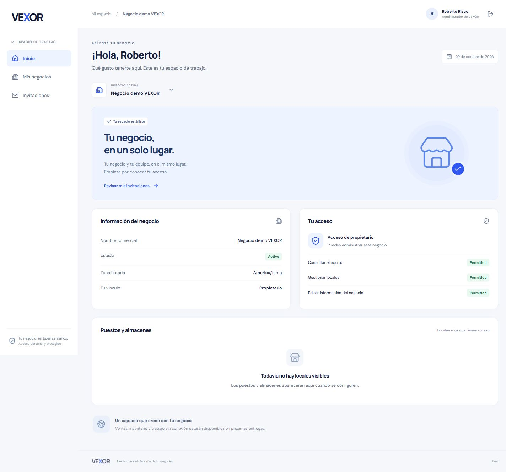
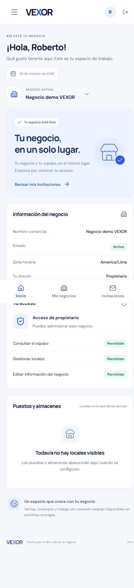
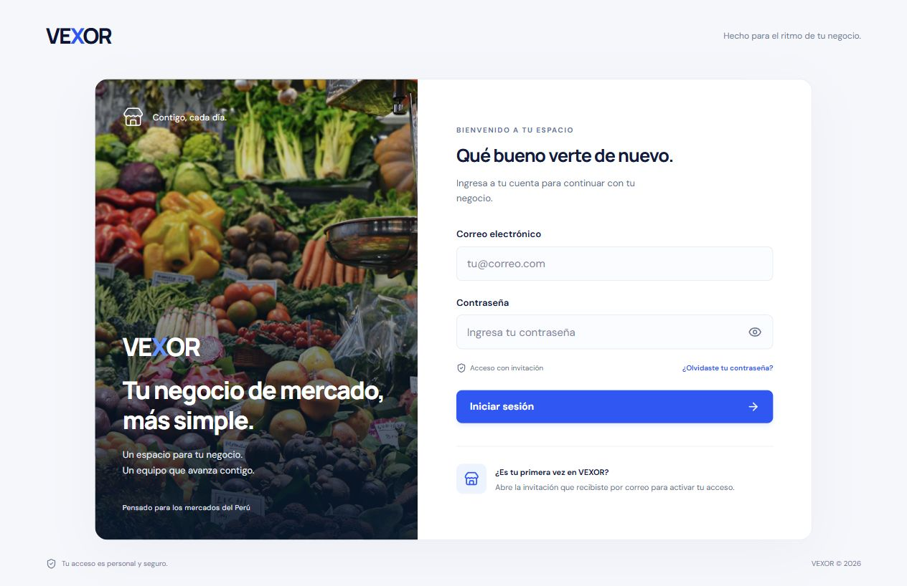

# Verificación del primer frontend

20 de octubre de 2026. Rama `codex/frontend-nucleo`.

## Resultados

| Comprobación                                        | Resultado                                                                                                                                                                                                                             |
| --------------------------------------------------- | ------------------------------------------------------------------------------------------------------------------------------------------------------------------------------------------------------------------------------------- |
| TypeScript del servidor y frontend                  | Correcto.                                                                                                                                                                                                                             |
| Compilación Nest y Vite de producción               | Correcta; React se compila en producción aunque el `.env` local del servidor indique desarrollo.                                                                                                                                      |
| Pruebas frontend                                    | 13 correctas: Bearer, paginación, 401/403, limpieza de secretos del callback, invitación/recuperación, código PKCE, enlaces incompletos/vencidos, pérdida de sesión y cierre voluntario.                                              |
| Regresión HTTP/backend                              | 98 comprobaciones correctas con PostgreSQL desechable y Auth local con JWT firmados.                                                                                                                                                  |
| Adaptador de Vercel ejecutado localmente            | Health 200, ready SQL 200 y `/me` sin sesión 401; respuestas privadas sin caché.                                                                                                                                                      |
| Contenido de entrega pública                        | Sin los valores de claves secretas, URLs SQL ni contraseñas de los archivos locales. Manifest standalone y PNG con dimensiones 192/512 correctos.                                                                                     |
| Navegador con backend real y vexor-dev              | Dashboard del negocio demo autenticado, perfil, propiedad y permisos visibles.                                                                                                                                                        |
| Recorrido real con el usuario                       | Correo confirmado, contraseña establecida personalmente, administrador habilitado, invitación comercial aceptada y dashboard visible.                                                                                                 |
| Lectura de PostgreSQL remoto posterior al recorrido | Un administrador activo, un negocio «Negocio demo VEXOR», una invitación correspondiente aceptada y un propietario activo.                                                                                                            |
| Navegador con base desechable                       | Login, error de acceso, selección entre dos negocios, dashboard propietario, trabajador sin locales asignados, tenant ajeno rechazado con 403, cuenta sin negocio, aceptación y alta desde invitación, cierre de sesión y menú móvil. |
| Responsive                                          | Escritorio de 1440 px y móvil de 390 px; sin desbordamiento horizontal del dashboard a 390 px.                                                                                                                                        |

El usuario introdujo su contraseña; el agente no la leyó, recibió ni guardó. No se volvieron a crear cuentas SQL. Los datos de la demo real quedan en vexor-dev porque son el negocio y acceso autorizados para continuar probando.

## Evidencia real

Estas capturas muestran el negocio real de desarrollo, no la fixture local.





También se comprobó el dashboard a 320 px y el acceso compilado a 320 px, sin desbordamiento horizontal. La pantalla de acceso abrió desde Vite preview sin errores ni advertencias en la consola del navegador.



## Auth, correo y límites de la evidencia

- Site URL de Auth: `http://localhost:5173`. Callback exacto permitido: `http://localhost:5173/auth/callback`. El backend conserva ese mismo redirect local.
- El primer envío de acceso fue aceptado por Supabase y el usuario completó correo/contraseña. La posterior invitación comercial quedó durable, pero su notificación devolvió `auth_rechazada`. El usuario la aceptó desde la PWA con su sesión vigente.
- Se comprobó en el Dashboard de Supabase que SMTP personalizado está desactivado. No se ha configurado un proveedor porque no existe una configuración SMTP local disponible para este bloque. No se atribuye el rechazo a una causa específica no confirmada.
- La habilitación del administrador y la solicitud de alta se ejecutaron después de que el usuario confirmó su identidad, destinatario y nombre exacto del negocio. El primer intento combinado fue rechazado por revisión automática hasta obtener esa confirmación. Un intento adicional de diagnóstico con posible reenvío también fue bloqueado; no se ejecutó ni se intentó eludirlo. La lectura posterior fue suficiente para validar el alta.
- La recuperación real dependió del correo y de la intervención del usuario. Los enlaces vencidos e incompletos y la limpieza del callback también tienen pruebas automatizadas; la sesión vencida tiene pruebas de estado y API.

## Pendientes

1. Configurar SMTP personalizado en Supabase y validar entrega a destinatarios externos, recuperación y reenvío. El acceso del administrador confirmado funciona; no se declara listo el correo general para clientes.
2. Crear el proyecto/preview de Vercel, cargar únicamente los secretos del servidor necesarios y registrar el origen/callback HTTPS definitivos. La configuración y el adaptador están preparados y comprobados localmente; todavía no se ha realizado un despliegue en Vercel.
3. Verificar en ese preview el enrutamiento, reutilización de conexiones, límites de funciones, manifest, worker e instalación standalone en un teléfono físico. El worker guarda exclusivamente una página pública de aviso; no se implementó sincronización offline.
4. Ventas, inventario y gestión comercial permanecen fuera de este bloque, tal como se solicitó.

La auditoría npm también detecta dos avisos moderados ya vinculados a Swagger/js-yaml del backend. No se aplicó una actualización mayor ajena al alcance; Swagger sigue deshabilitado en producción. El frontend no incorpora esos módulos en su bundle.

## Reproducir

```powershell
npm ci
npm run typecheck
npm run build
npm run test:web
npm run test:api
npm run test:hosting
node --env-file=.env --env-file=.env.runtime --import tsx scripts/test-client-build.ts
```

`test:hosting` y la revisión de valores privados requieren los archivos locales ya existentes. `test:api` usa su propia base desechable. `npm run demo:browser` abre el entorno aislado para repetir manualmente el recorrido de varios usuarios; no envía correos reales ni escribe en Supabase.

Resultados auxiliares y evidencia de callback y acceso denegado: `test-results/`, ignorado por Git. [Diseño y ejecución del frontend](../diseno/FRONTEND_NUCLEO.md).
