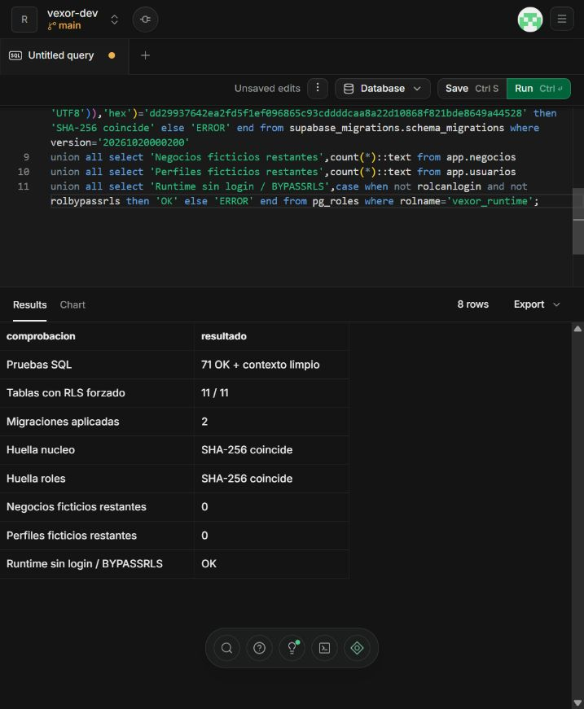

# Verificación del núcleo — 20 de octubre de 2026

Bloque aplicado y probado en el proyecto de desarrollo Supabase **vexor-dev**, referencia `xlkuqntkxzwayyxovoxy`, PostgreSQL 17.11. La API de datos está desactivada; la cuenta administradora fue usada para migraciones y pruebas, no para tráfico de aplicación.

## Migraciones aplicadas

| Versión | Nombre | SHA-256 del archivo UTF-8 con saltos LF |
| --- | --- | --- |
| `20261020000100` | `nucleo` | `35b529b369c6ec8ff295af5058270854f58ef5a74daba9973169b1d7a6709450` |
| `20261020000200` | `runtime_migraciones` | `dd29937642ea2fd5f1ef096865c93cddddcaa8a22d10868f821bde8649a44528` |

Se ejecutaron los archivos versionados mediante el SQL Editor de la sesión autorizada. Cada migración quedó registrada en `supabase_migrations.schema_migrations` con su versión, nombre y SQL fuente. Se compararon ambas huellas desde PostgreSQL con los archivos locales; coinciden. Se normalizaron a LF los saltos CRLF introducidos por el portapapeles de Windows. El historial está protegido con RLS forzado y sin acceso para roles de la API o del runtime.

La prueba remota inicial detectó que `postgres` de Supabase no podía hacer SET ROLE a `vexor_runtime`. La segunda migración resolvió esa diferencia y se aplicó después de autorización expresa del usuario para `GRANT vexor_runtime TO postgres`. La primera migración aplicada se mantuvo intacta. La concesión permite al administrador asumir un rol de menor privilegio; no concede acceso administrativo al runtime ni crea un login.

## Resultados

| Comprobación | Resultado |
| --- | --- |
| Creación desde cero en PostgreSQL embebido/PGlite | Las dos migraciones aplicadas; 71 comprobaciones SQL correctas. |
| Creación desde cero en PostgreSQL 17.11 / Docker | Las dos migraciones aplicadas; las mismas 71 comprobaciones correctas. |
| SQL en Supabase desarrollo | Las mismas 71 comprobaciones correctas, bajo `SET LOCAL ROLE vexor_runtime`. |
| Conexión reutilizada después de la transacción | Actor y negocio limpios; ninguna fila accesible sin contexto. Comprobado también en Supabase. |
| Copropietarios concurrentes / READ COMMITTED | Una baja confirma; la otra se rechaza al no conservar propietario. |
| Copropietarios concurrentes / REPEATABLE READ | Una baja confirma; la otra se rechaza por serialización. |
| Kysely/pg y login sin privilegios, pool de una conexión | Acceso autorizado, permiso ausente y tenant sin membresía rechazados; rollback y limpieza comprobados. |
| Kysely con conexión administrativa | Rechazada antes del trabajo comercial. |
| TypeScript | `npm run typecheck` correcto. |
| RLS remoto | 11 de 11 tablas del núcleo con RLS habilitado y forzado. |
| Datos ficticios remotos | ROLLBACK; cero negocios y perfiles restantes. |
| Rol runtime remoto | Sin login, sin BYPASSRLS y sin superusuario. |

Las pruebas cubren pertenencia a dos negocios, identidad compartida con membresías separadas, intento de cambiar tenant, SELECT/INSERT/UPDATE/DELETE no autorizados, FKs entre negocios, permisos individuales positivos y negativos, vigencia/revocación, locales asignados, asignación de roles protegida, auditoría protegida y conservación del último propietario.

La concurrencia y la integración Kysely se probaron en PostgreSQL 17.11 local; **no se atribuyen esas pruebas de conexiones simultáneas al Dashboard remoto**. La suite SQL transaccional sí se ejecutó en Supabase.

## Reproducción y límites

```powershell
npm ci
npm run typecheck
npm run db:test
npm run db:test:postgres
```

El código de las pruebas está en `tests/db/nucleo.sql` y `scripts/test-postgres.ts`. `tests/db/bootstrap.sql` se usa exclusivamente en las bases desechables, nunca en Supabase. Los contenedores creados para las pruebas fueron retirados.

No se han implementado ni declarado probados endpoints NestJS, validación HTTP/JWT, pantallas, permisos offline, sincronización de ventas, pruebas de carga o restauración de respaldos. La cuenta LOGIN del futuro backend se aprovisionará al desplegar ese backend, con credenciales fuera del repositorio. Las once tablas no constituyen aprobación de las 60 tablas propuestas.

[Diseño físico y contrato de seguridad](../diseno/NUCLEO_BASE_DATOS.md).

## Evidencia remota


